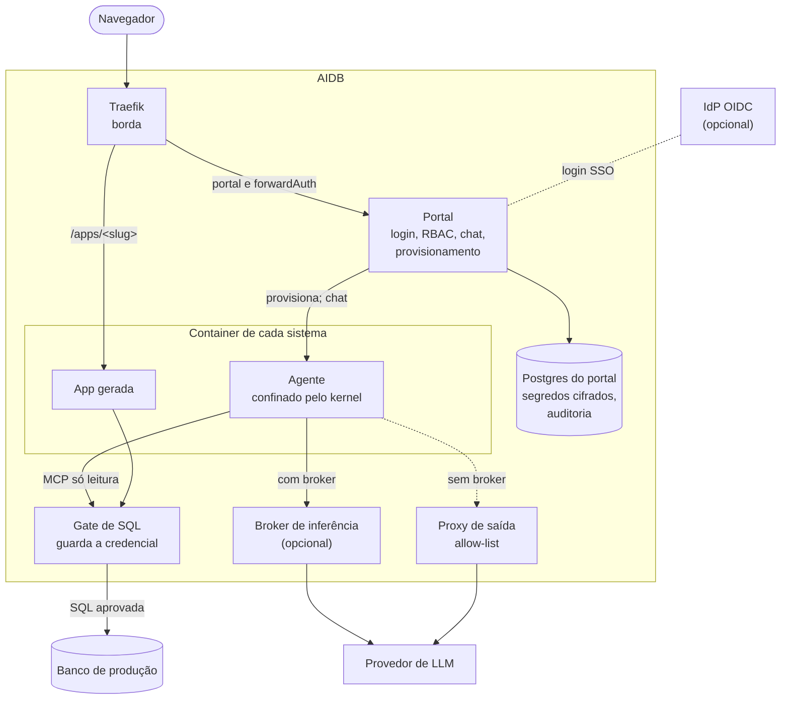
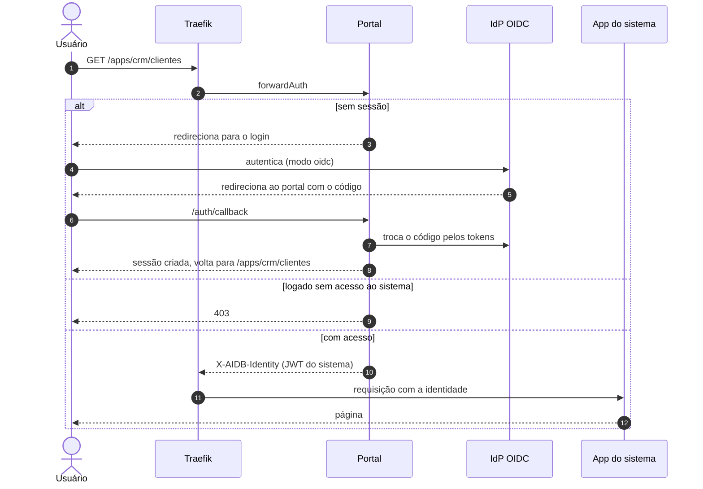
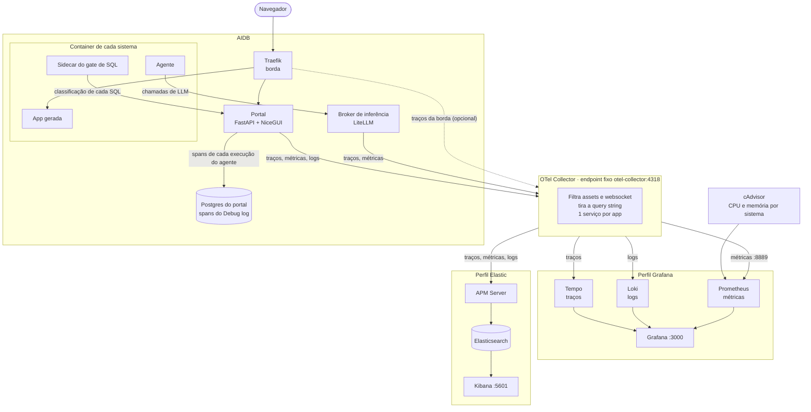

# AIDB

[](LICENSE)
[](https://www.python.org/)
[](https://fastapi.tiangolo.com/)
[](https://nicegui.io/)
[](docs/guia-de-uso.md)
[](#instalação)
[](docs/driver-kubernetes.md)
[](https://opencode.ai/)
[](openspec/specs/)
[](https://github.com/alanyoshida/aidb/commits/main)

Portal que cria **sistemas de gestão com IA sobre seus bancos de dados**: você cadastra um sistema, conecta um banco (PostgreSQL, MySQL ou BigQuery), conversa com o agente pelo chat do portal e ele gera uma app administrativa (NiceGUI, 100% Python) que sobe automaticamente e fica acessível em `/apps/<slug>`.

## Destaques

- **Gera apps administrativas reais a partir de um chat em PT-BR**, sobre o schema de verdade do seu banco (via MCP) — não um template estático. Checkpoints permitem voltar o código a qualquer ponto.
- **Isolamento de verdade por sistema**: cada container roda confinado por seccomp + Landlock, aplicado pelo kernel — não depende de aprovar um pedido de permissão no chat (ver [Segurança](#segurança)).
- **Gate de SQL no data plane**: um `DROP` ou `DELETE` sem `WHERE` nunca chega ao banco — recusado por um sidecar classificador, sem pedir aprovação a ninguém.
- **Segredos nunca tocam o container do sistema**: credenciais de banco e chaves de LLM ficam cifradas no portal; com o broker de inferência (opcional), o sistema nem recebe a chave real — só um token opaco revogável.
- **Mesma lógica de negócio em Docker ou Kubernetes**: o driver de provisionamento é uma abstração comum, validada ponta a ponta nos dois (ver [Instalação](#instalação)).
- **Mudanças planejadas pelo chat com OpenSpec**: o agente de cada sistema já vem com o OpenSpec
  1.15.0 (versão pinada na imagem base, sem depender de rede) e os comandos `/opsx-propose`,
  `/opsx-explore`, `/opsx-apply` e `/opsx-archive`. Ao digitar `/` no chat, o campo sugere os
  comandos disponíveis no agente daquele sistema (ver [guia de uso](docs/guia-de-uso.md#chat)).
- **Observabilidade OpenTelemetry sem amarrar backend**: traços, métricas e logs saem por OTLP
  para um Collector, e quem decide o destino é a configuração dele. Há exemplos prontos para
  **Elastic** (APM + Kibana) e **Grafana** (Tempo, Loki e Prometheus), e cada app gerada aparece
  como um serviço próprio no APM (ver [Observabilidade](#observabilidade)).
- **Pilha 100% Python**, do portal (FastAPI + NiceGUI) à app gerada (NiceGUI) — sem troca de linguagem/framework em nenhuma camada.

## Arquitetura



- **Portal**: único lugar com credenciais e chaves, cifradas no Postgres dele. Cria, reconcilia e
  arquiva os sistemas pelo driver (Docker ou Kubernetes). O Traefik consulta o portal
  (`forwardAuth`) antes de entregar cada requisição a uma app.
- **Container do sistema**: o supervisor (PID 1) confina o agente com seccomp e Landlock, de
  filesystem e de rede; a app gerada roda sem esse confinamento, mas também só fala com o banco
  pelo gate. O container não vê a senha do banco, e com o broker ligado também não vê a chave do
  LLM.
- **Gate de SQL**: com PostgreSQL e MySQL, toda SQL do agente e da app passa pelo sidecar, que
  recusa operações destrutivas antes de chegarem ao banco e manda cada decisão para a auditoria do
  portal.
- **Saída**: a internet do agente passa só pelo proxy de saída, com allow-list. Com o broker
  ligado, a inferência vai direto ao broker, numa porta liberada pelo Landlock.
- Decisões de arquitetura: [`docs/adr/`](docs/adr/README.md) (36 ADRs, formato MADR).
- Observabilidade (traços, métricas e logs): diagrama em [Observabilidade](#observabilidade).
- Especificações formais: `openspec/specs/` (30 capacidades); histórico de mudanças em `openspec/changes/archive/`.

## Dependências

- Docker 24+ com Compose v2
- Porta 80 livre
- ~2 GB RAM por sistema ativo (padrão; ver [Configuração](docs/configuracao.md) para limites)

## Instalação

Duas formas de subir o portal, conforme o **driver de provisionamento** (o que materializa cada
sistema — container Docker ou Pod Kubernetes). O driver padrão, e o único validado para produção,
é o Docker.

### Opção 1 — Docker (padrão, produção)

```bash
cd deploy
docker compose up -d --build          # postgres + mysql + traefik + portal
docker compose exec portal alembic upgrade head   # migrações (opcional: o portal cria o schema no boot)
```

- O serviço `mysql` do compose existe só como banco de teste para cadastrar conexões MySQL (host `mysql`, porta 3306, banco/usuário/senha `appaiforge`); as portas dos bancos não são publicadas no host.
- Portal: http://localhost (admin semeado em dev: `admin@appaiforge.local` / `admin123` — `APPAIFORGE_SEED_DEMO_ADMIN=1` no compose)
- Health: http://localhost/api/health

Em vez do admin semeado, crie o primeiro admin por CLI (produção):

```bash
docker compose -f deploy/docker-compose.yml exec portal appaiforge create-admin --email voce@empresa.com --password 'uma-senha-forte'
# e remova a variável APPAIFORGE_SEED_DEMO_ADMIN do compose
```

Sem chave de LLM cadastrada, o portal opera em **modo fake** (todo o resto funciona) — para geração real, ver [Chave de LLM e broker de inferência](docs/llm-e-broker.md).

### Opção 2 — Kubernetes (driver alternativo, validação local)

```bash
docker build -f deploy/portal.Dockerfile -t appaiforge/portal:1.13.1 .
kind load docker-image appaiforge/portal:1.13.1 --name appaiforge-dev

helm install appaiforge-portal deploy/helm/appaiforge-portal \
  --namespace appaiforge --create-namespace \
  --kube-context kind-appaiforge-dev
```

Materializa cada sistema como um Pod em vez de container Docker; só validado contra um cluster
`kind` local (nunca contra um cluster gerenciado real). Detalhes, pré-requisitos (Traefik no
cluster) e o chart Helm completo: [Driver Kubernetes](docs/driver-kubernetes.md).

## Segurança

Cada sistema roda isolado, com várias camadas independentes — uma falha numa não derruba as outras:

- **Confinamento do agente** (3 modos de execução; `sandboxed` por padrão quando o host suporta
  Landlock, senão cai para `reduced` com aviso): seccomp nega um denylist de syscalls perigosas e
  Landlock nega acesso a filesystem/rede fora do declarado no perfil do agente — aplicados pelo
  próprio supervisor (PID 1), irrevogáveis, sem depender de ninguém clicar "Aprovar"
  ([ADR 0018](docs/adr/0018-perfil-de-runtime-do-agente-e-identidade-reduzida.md),
  [ADR 0019](docs/adr/0019-sandbox-seccomp-landlock-no-supervisor.md)).
- **Proxy HTTP(S) de saída obrigatório por sistema**: a única saída de internet do agente passa
  por um sidecar com allow-list calculada (provedor de LLM/broker + registros de pacote) —
  `443`/`80` saíram do Landlock fixo exatamente por isso
  ([ADR 0024](docs/adr/0024-proxy-http-s-de-saida-obrigatorio-por-sistema.md)).
- **Gate de operações destrutivas**: toda SQL que toca um banco de conexão passa por um
  classificador (sqlglot) rodando num sidecar no data plane. No modo `enforce` (default),
  `DROP`/`TRUNCATE`/`ALTER` e `DELETE`/`UPDATE` sem escopo por chave são recusados na hora, sem
  pedir aprovação a ninguém; o modo `shadow` classifica e audita sem bloquear, para observar um
  sistema antes de confiar nele
  ([ADR 0017](docs/adr/0017-gate-de-operacoes-destrutivas-com-classificador-sql.md),
  [ADR 0021](docs/adr/0021-gate-de-sql-no-data-plane-via-sidecar-proxy.md)).
- **Segredos cifrados em repouso**: chaves de provedor de LLM e credenciais de conexão de banco
  ficam cifradas no Postgres do portal, nunca em texto puro
  ([ADR 0007](docs/adr/0007-metadados-em-postgres-e-credenciais-cifradas.md)).
- **Catálogo de bancos com DB Manager**: as credenciais de banco ficam com quem tem a capacidade
  de DB Manager, que autoriza cada conexão por sistema com um teto de modo de acesso; o dono do
  sistema só ativa o que foi autorizado, com alias próprio, sem ver host nem usuário. A liberação
  de DDL (`schema_admin`) vale só para o agente
  ([ADR 0036](docs/adr/0036-catalogo-de-conexoes-autorizacao-e-ativacao.md)).
- **Autenticação local ou SSO (OIDC)**, escolhida por ENV e travada na instalação, com admin
  break-glass; o acesso a cada app é verificado pelo portal a cada requisição e a app recebe a
  identidade num JWT restrito a ela ([ADR 0027](docs/adr/0027-sso-oidc-e-identidade-das-apps-por-forwardauth.md),
  ver [Login e SSO](#login-e-sso)).
- **RBAC**: tipo global por usuário — `admin` (tudo), `editor` (cria e gerencia sistemas) ou
  `app_user` (só usa as apps de sistemas a que tem acesso); sem papel por sistema
  ([ADR 0014](docs/adr/0014-rbac-com-tipos-globais-de-usuario.md), ver [Usuários e papéis](#usuários-e-papéis)).
- **Broker de inferência** (opcional): o container do sistema carrega só um token opaco em vez da
  chave do provedor, revogável por sistema ou por sessão de chat
  ([ADR 0020](docs/adr/0020-broker-de-inferencia-com-litellm.md), ver [LLM e broker](docs/llm-e-broker.md)).
- **Auditoria**: toda ação de escrita da gestão e toda decisão do gate (aprovada/recusada/
  bloqueada) fica numa trilha sem segredos.

Confinamento do agente e gate de destrutivas por dentro: [`docs/seguranca.md`](docs/seguranca.md).
Broker de inferência: [`docs/llm-e-broker.md`](docs/llm-e-broker.md). Segredos cifrados e RBAC:
os ADRs linkados acima.

## Usuários e papéis

Cada usuário tem **um tipo global**, que vale para o portal inteiro. Não há papel por sistema
([ADR 0014](docs/adr/0014-rbac-com-tipos-globais-de-usuario.md)).

| Tipo | O que pode fazer |
|---|---|
| `admin` | Tudo: usuários, grupos, chaves de LLM, catálogo de bancos e todos os sistemas, inclusive arquivar e excluir. |
| `editor` | Cria sistemas e vira dono deles. No próprio sistema, conversa com o agente, ativa bancos autorizados, implanta e configura. Também abre as apps dos sistemas a que tem acesso. |
| `app_user` | Só usa as apps dos sistemas liberados para ele. Não vê chat, código nem configuração. |

- **DB Manager** é uma capacidade que se soma ao tipo (um editor pode ser também DB Manager). Quem a
  tem gere o catálogo de conexões de banco e autoriza cada conexão para um sistema, com um teto de
  modo de acesso. O dono do sistema só ativa o que foi autorizado, sem ver host nem usuário
  ([ADR 0036](docs/adr/0036-catalogo-de-conexoes-autorizacao-e-ativacao.md)).
- **Acesso a um sistema**: o dono, os admins e os membros de um **grupo** vinculado ao sistema. Um
  usuário pode estar em vários grupos, e um grupo pode dar acesso a vários sistemas.
- **Admin break-glass**: um admin de emergência definido só por variável de ambiente, que entra
  mesmo com o SSO fora do ar. Cada tentativa vai para a auditoria, e a sessão dura até 8 h.

Quem define tipo, capacidade e grupos depende do modo de login:

| | Modo `local` | Modo `oidc` (SSO) |
|---|---|---|
| Tipo | o admin escolhe no portal | papel `admin`, `editor` ou `app_user` no IdP (vale o maior) |
| DB Manager | o admin concede em *Administração → Usuários* | papel `db_manager` no IdP |
| Grupos | o admin põe o usuário no grupo | claim de grupos do token, casado pelo nome exato |

## Login e SSO

O portal autentica em **um** de dois modos, escolhido por `APPAIFORGE_AUTH_MODE` e gravado no
primeiro boot: trocar o modo de uma instalação existente não é suportado
([ADR 0027](docs/adr/0027-sso-oidc-e-identidade-das-apps-por-forwardauth.md)).

- **`local`** (padrão): e-mail e senha cadastrados pelo admin no portal.
- **`oidc`**: login pelo IdP da empresa (validado com Keycloak), com authorization code + PKCE.
  Tipo, DB Manager e grupos vêm do token a cada login e a cada revalidação, no máximo a cada 5
  minutos. Perder o papel ou ser desativado no IdP vale nesse prazo, e sair do portal também encerra
  a sessão no IdP. Sem nenhum dos papéis `admin`, `editor` ou `app_user`, o login é recusado.

```bash
APPAIFORGE_AUTH_MODE=oidc
APPAIFORGE_PUBLIC_BASE_URL=https://aidb.empresa.com
APPAIFORGE_OIDC_ISSUER=https://sso.empresa.com/realms/aidb
APPAIFORGE_OIDC_CLIENT_ID=aidb-portal
APPAIFORGE_OIDC_CLIENT_SECRET=<segredo do client>
```

**Acesso às apps com a identidade do portal.** As apps geradas não têm login próprio: toda
requisição a `/apps/<slug>` passa antes pelo portal (`forwardAuth` do Traefik), nos dois modos.



A app recebe no header `X-AIDB-Identity` um JWT assinado com o segredo do próprio sistema, com
e-mail, tipo e grupos do usuário, e o valida em toda requisição. O token do IdP nunca chega à app, e
um header enviado pelo cliente é sempre sobrescrito. Configuração do IdP, claims, grupos,
break-glass e o E2E com Keycloak local: [`docs/autenticacao.md`](docs/autenticacao.md).

## Observabilidade

Portal e broker são instrumentados com OpenTelemetry e mandam tudo por OTLP para **um único
endpoint de Collector**. O código nunca fala direto com Elastic, Grafana ou outro backend: trocar
de backend é trocar a configuração do Collector, sem mexer no portal
([ADR 0025](docs/adr/0025-telemetria-otel-agnostica-de-backend.md),
[ADR 0033](docs/adr/0033-auto-instrumentacao-do-portal-e-elastic-apm.md)). Tudo é opcional: sem
as variáveis `APPAIFORGE_OTEL_*`, nada é exportado e nada muda no funcionamento.



Só um dos dois perfis (Grafana ou Elastic) fica de pé por vez, porque os dois Collectors usam o
mesmo nome de rede `otel-collector`. No Kubernetes, o chart traz o próprio Collector (desligado
por padrão) e o repassa a qualquer endpoint OTLP externo.

### O que é coletado

- **Traços**:
  - uma transação por requisição HTTP ao portal e ao broker, com as consultas ao banco do portal
    e as chamadas HTTP de saída como filhos. O contexto W3C (`traceparent`) é propagado de ponta a
    ponta, então a chamada do broker ao portal cai no mesmo traço;
  - um span raiz `agent.run` por execução do agente. Ficam pendurados nele as consultas SQL (vindas
    do sidecar do gate), as chamadas de ferramenta, as decisões do gate e as chamadas de LLM,
    incluindo a chamada do broker ao provedor.
- **Cada app como um serviço** (opcional, tracing do Traefik ligado): cada pedido a `/apps/<slug>`
  vira uma transação no serviço `<slug>`, com o caminho dentro da app e os identificadores trocados
  por `{id}` (ex.: `GET /clientes/{id}` no serviço `crm`)
  ([ADR 0035](docs/adr/0035-borda-das-apps-como-servicos-no-apm.md)).
- **Métricas**:
  - duração e contagem de requisições HTTP, uso do pool de conexões do banco do portal, e CPU e
    memória do processo do portal e do broker;
  - CPU e memória de cada sistema, rotuladas por `slug` e `system_id`. No Docker vêm do
    cAdvisor, que também conta os processos ([ADR 0026](docs/adr/0026-metricas-de-recursos-por-container-via-cadvisor.md)); no
    Kubernetes, do kubelet de cada nó.
- **Identificação**: todo dado sai com `service.name` (`appaiforge-portal` ou
  `appaiforge-broker`), a versão e a instância. O ambiente vem de
  `OTEL_RESOURCE_ATTRIBUTES=deployment.environment=<nome>`.

### Logs

- **Eventos estruturados do portal**, exportados por OTLP pelo logger `appaiforge.telemetry`:
  - tentativas de login, com sucesso ou falha (nunca a senha);
  - mudanças na rede de um sistema (internet, modo restrito, allow-list);
  - mudanças no ciclo de vida de um sistema (arquivar, excluir, status);
  - prompts enviados no chat, com o sistema e a sessão;
  - espelho de toda ação da auditoria de gestão, com os mesmos campos sem segredos.

  No perfil Grafana eles chegam ao **Loki**; no perfil Elastic, ao **Elasticsearch** (via APM
  Server), consultáveis no Kibana.
- **Debug log do chat**: os spans de cada execução do agente também ficam no Postgres do portal (30
  dias por padrão, `APPAIFORGE_OTEL_SPAN_RETENTION_DAYS`). O Debug log mostra a árvore da execução
  mesmo sem nenhum backend de observabilidade de pé.
- **Logs dos processos**: `docker compose logs -f portal` e `docker logs appaiforge-sys-<slug>`.
  Os containers dos sistemas não exportam por OTLP; o que o agente faz chega pelos spans acima.
- **Fonte de verdade**: a auditoria de gestão e as decisões do gate continuam no Postgres do portal.
  Os logs centralizados são uma cópia para consulta; perder o backend não perde a auditoria.

O que nunca entra na telemetria:
- a query string das URLs (removida no portal e no broker; nos spans da borda, no Collector);
- cabeçalhos e corpos de requisição;
- os valores dos parâmetros SQL;
- as consultas aos bancos cadastrados pelos usuários, que não são instrumentadas;
- o health check, os arquivos estáticos e o websocket da interface, que não geram spans.

### Subir no compose

Aponte portal e broker para o Collector (no shell ou no `.env` ao lado do `docker-compose.yml`):

```bash
export APPAIFORGE_OTEL_TRACES_ENDPOINT=http://otel-collector:4318/v1/traces
export APPAIFORGE_OTEL_LOGS_ENDPOINT=http://otel-collector:4318/v1/logs
export APPAIFORGE_OTEL_METRICS_ENDPOINT=http://otel-collector:4318/v1/metrics
```

**Grafana** (Tempo + Loki + Prometheus, com o dashboard de recursos por sistema já provisionado),
em http://localhost:3000:

```bash
docker compose --profile observability --profile metrics up -d
```

**Elastic** (Elasticsearch, Kibana e APM Server 9.5.6), em http://localhost:5601, menu
Observability → APM:

```bash
docker compose --profile observability-elastic up -d
```

Para mandar a um Elastic próprio, suba só o Collector do perfil com
`APM_SERVER_ENDPOINT=<host>:8200`. Para ver cada app como um serviço, recrie o Traefik com
`APPAIFORGE_TRAEFIK_CONFIG=traefik-otel.yml`. No Kubernetes, ligue `observability.enabled` no chart
e informe `observability.exporter.endpoint`; o token do destino fica num Secret lido só pelo
Collector. Passo a passo, Elastic externo e chart: [Operação](docs/operacao.md#observabilidade-elastic-apm)
e [Observabilidade no chart](deploy/helm/appaiforge-portal/README.md#observabilidade)
([ADR 0034](docs/adr/0034-observabilidade-no-chart-kubernetes.md)).

## Documentação

A documentação também está publicada como site, com busca: **https://alanyoshida.github.io/aidb/**.

| Tema | Onde |
|---|---|
| Criar um sistema, chat, editor, aparência | [`docs/guia-de-uso.md`](docs/guia-de-uso.md) |
| Login local, SSO por OIDC (Keycloak), break-glass e acesso às apps | [`docs/autenticacao.md`](docs/autenticacao.md) |
| Gate de operações destrutivas e confinamento do agente | [`docs/seguranca.md`](docs/seguranca.md) |
| Chave de LLM e broker de inferência (LiteLLM) | [`docs/llm-e-broker.md`](docs/llm-e-broker.md) |
| Instalação sob o driver Kubernetes (chart Helm) | [`docs/driver-kubernetes.md`](docs/driver-kubernetes.md) |
| Todas as variáveis de ambiente `APPAIFORGE_*` | [`docs/configuracao.md`](docs/configuracao.md) |
| Rodar a suíte de testes (unit/BDD/integration/E2E) | [`docs/testes.md`](docs/testes.md) |
| Rollback, logs, auditoria, backup, reconciliação | [`docs/operacao.md`](docs/operacao.md) |
| Observabilidade: Elastic APM, Grafana, cada app como serviço | [`docs/operacao.md`](docs/operacao.md#observabilidade-elastic-apm) |
| Decisões de arquitetura (ADRs) | [`docs/adr/`](docs/adr/README.md) |
| Roadmap de confinamento do agente | [`docs/roadmap-confinamento-do-agente.md`](docs/roadmap-confinamento-do-agente.md) |

## Estrutura

```
portal/       appaiforge/ (FastAPI+NiceGUI), tests/ (unit, bdd, integration, e2e), migrations/
base-image/   Dockerfile da imagem dos sistemas + afsupervisor (PID 1) + gated-mcp/ (MCP somente leitura com o gate)
deploy/       docker-compose.yml (postgres, mysql, traefik, portal), docker-compose.e2e.yml e helm/ (chart do portal p/ driver Kubernetes)
docs/         guias de uso, segurança, configuração etc. (acima) e docs/adr/ (decisões de arquitetura)
openspec/     specs vigentes (specs/) e histórico de changes (changes/archive/)
site/         site de apresentação e documentação (Astro Starlight), publicado no GitHub Pages
```

## Licença

Distribuído sob a licença MIT: uso, modificação e redistribuição livres, inclusive para fins comerciais, desde que o aviso de copyright e o texto da licença acompanhem as cópias. Veja [`LICENSE`](LICENSE).
