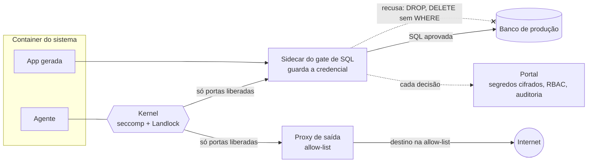

import { Aside, LinkCard, CardGrid } from '@astrojs/starlight/components';

O AIDB trata o agente de IA como **código não confiável** rodando ao lado do seu banco de produção.
Por isso a segurança não depende de o agente se comportar, nem de alguém clicar em "Aprovar" num
pedido de permissão: cada barreira é aplicada **fora do agente**, pelo kernel, por um processo
separado no caminho dos dados ou pelo portal. São camadas independentes; uma falha numa não abre as
outras.

## O que cada camada impede

| Risco | Camada | Onde é aplicada |
|---|---|---|
| O agente apagar ou alterar dados em massa | Gate de SQL: `DROP`, `TRUNCATE`, `ALTER` e `DELETE`/`UPDATE` sem escopo por chave são recusados | Sidecar no caminho dos dados, protocolo de fio do banco |
| O agente ler a senha do banco | O container só recebe um endereço local sem usuário nem senha; só o sidecar tem a credencial | Portal, ao provisionar |
| O agente ir direto ao banco, contornando o gate | Landlock de rede: conexão TCP de saída só nas portas calculadas para o sistema | Kernel |
| O agente ler arquivos de outro sistema ou do host | Landlock de filesystem: leitura e escrita só nos caminhos do perfil do agente | Kernel |
| O agente escalar privilégio ou espiar processos | seccomp nega `ptrace`, `bpf`, `mount`, `setns`, `unshare` de user namespace e outras | Kernel |
| O agente mandar dados para qualquer site | Proxy de saída obrigatório, com allow-list por sistema | Sidecar de rede |
| A chave do provedor de LLM vazar | Com o broker de inferência, o container carrega só um token opaco e revogável | Broker (LiteLLM) |
| Alguém sem permissão abrir uma app | Toda requisição a `/apps/<slug>` é verificada pelo portal antes de chegar à app | Traefik + portal |
| Um segredo ir parar numa imagem publicada | Três verificações antes do envio ao registry, incluindo trivy e gitleaks na imagem construída | CI |

## Confinamento do agente

Cada sistema roda num container próprio. O supervisor (PID 1 do container) aplica o confinamento no
processo que vira o agente, antes de ele começar, e todo processo que o agente criar herda as
mesmas regras. Depois de aplicadas, elas não podem ser retiradas.

| Modo | Usuário | Capabilities | Landlock + seccomp |
|---|---|---|---|
| `sandboxed` (padrão) | `agent` (uid 1000) | nenhuma | sim |
| `reduced` | `agent` (uid 1000) | nenhuma | não |
| `legacy` | root | todas | não |

Um sistema novo nasce em `sandboxed` quando o kernel do host tem Landlock. Sem suporte, cai para
`reduced` com aviso, ou a criação é recusada se `APPAIFORGE_REQUIRE_SANDBOX=true`, o modo de produção
que falha fechado.

- **seccomp** nega uma lista de syscalls perigosas e permite o resto.
- **Landlock de filesystem**: leitura e execução só no workspace do sistema, nas bibliotecas do
  sistema e num conjunto explícito de arquivos de `/etc`; escrita só no workspace, em `/tmp` e nos
  caches do agente. `/etc/shadow`, `/root` e os workspaces dos outros sistemas ficam negados.
- **Landlock de rede**: conexões TCP de saída só para o sidecar do gate de cada banco, o broker de
  inferência (quando ligado), o proxy de saída e DNS. A regra é por porta, então vale mesmo que o
  agente descubra o endereço real do banco.

## Gate de SQL

Toda SQL que vai a um banco PostgreSQL ou MySQL passa por um sidecar que entende o protocolo do
banco e classifica cada comando antes de repassá-lo. Isso vale para o agente e para a app gerada,
cada um num listener próprio, então a origem de cada comando é conhecida.

| Classe | Exemplo | No modo `enforce` (padrão) |
|---|---|---|
| normal | `DELETE FROM clientes WHERE id = 42` | executa |
| confirmável | `DELETE FROM clientes` ou `WHERE cidade = 'Recife'` | recusada na hora |
| bloqueada | `DROP`, `TRUNCATE`, `ALTER` | recusada na hora |

Ninguém é chamado a aprovar nada: um pedido de confirmação aprovado por hábito deixaria passar
justamente o `DELETE` que importa ([ADR 0023](/aidb/decisoes/0023-confirmavel-recusado-direto-sem-pedir-aprovacao/)).
O gate avalia cada comando isoladamente; veja os [limites conhecidos](#limites-conhecidos).
Quando o agente tenta, a recusa aparece no chat com o comando e o motivo, e toda decisão fica na
auditoria do sistema. O modo `shadow` classifica e audita sem bloquear, para observar um sistema
antes de confiar nele.

### Modos de acesso e liberação de DDL

As conexões ficam num catálogo gerido pelo **DB Manager**, que autoriza cada uma para um sistema com
um teto de modo de acesso. O dono do sistema ativa a conexão num modo igual ou abaixo do teto, sem
ver host, usuário nem senha.

- `read_only` e `read_write`: o MCP do agente é sempre só leitura; o gate vale para tudo o mais.
- `schema_admin`: libera DDL e operações em massa **só para o agente**, para ele criar e
  reestruturar tabelas no começo de um sistema. A app continua com o gate normal. Cada comando
  liberado é auditado, e a página mostra "DDL liberada desde" até alguém rebaixar o modo.

## Rede de saída

A única saída HTTP(S) do agente é um proxy por sistema. Ele só abre o túnel para destinos de uma
allow-list: o provedor de LLM (ou o broker, nunca os dois) e os registros de pacote (PyPI e npm). O
proxy não decifra TLS. Por sistema, o editor pode desligar a internet ou ligar o **modo restrito**,
em que a allow-list passa a ser só a lista de domínios cadastrada na aba Domínios.

## Segredos

- Chaves de provedor de LLM e credenciais de banco ficam **cifradas** no Postgres do portal.
- A credencial do banco vai só para o sidecar do gate. O container do sistema recebe
  `DATABASE_URL_<ALIAS>` apontando para o sidecar, sem usuário nem senha.
- Com o **broker de inferência** ligado, o container recebe um token opaco no lugar da chave do
  provedor. O token pode ser revogado por sistema ou por sessão de chat.
- Nenhuma imagem do projeto é publicada com segredo dentro: o contexto de build exclui arquivos de
  segredo, um teste recusa `ARG`/`ENV` com nome de segredo, e trivy e gitleaks varrem a imagem
  construída antes do envio.

## Identidade, acesso e auditoria

- **Tipos de usuário** globais (`admin`, `editor`, `app_user`) e a capacidade de DB Manager. Ver
  [Usuários e papéis](/aidb/identidade/usuarios-e-papeis/).
- **Login local ou SSO por OIDC**, com admin de emergência definido só por variável de ambiente.
  Ver [Login e SSO](/aidb/identidade/login-e-sso/).
- **Acesso às apps** verificado pelo portal a cada requisição. A app recebe a identidade num JWT
  assinado com o segredo do próprio sistema; o token do IdP nunca chega a ela.
- **Auditoria**: toda ação de escrita na gestão e toda decisão do gate ficam registradas, sem
  segredos, no Postgres do portal.

## Limites conhecidos

<Aside type="caution" title="O que estas camadas ainda não cobrem">

- **O gate julga um comando por vez.** Um `DELETE` em massa é recusado, mas o agente pode apagar as
  mesmas linhas uma a uma, cada `DELETE` pela chave, e cada comando passa. Isso aconteceu ao pedir
  ao agente que apagasse os pedidos cancelados de uma base de teste: ele recebeu a recusa e refez a
  operação linha a linha. Para dados que não podem sumir, cadastre a conexão com um usuário de banco
  sem permissão de escrita nessas tabelas.
- **`read_only` só vale no MCP do agente.** O proxy não distingue `read_only` de `read_write`: o
  terminal do agente e a app ainda conseguem fazer escritas com escopo. Para leitura de verdade,
  cadastre a conexão com um usuário de banco que só tenha permissão de leitura.
- **A app gerada não roda sob Landlock.** Ela passa pelo gate de SQL, mas não tem o confinamento de
  filesystem e rede do agente.
- **Exfiltração pelo próprio prompt.** O endpoint do LLM é legítimo; o agente pode mandar conteúdo
  do workspace por ele.
- **Sistemas em `legacy` ou `reduced`** não têm as garantias do Landlock.
- **BigQuery** não passa pelo sidecar: o acesso do agente é só leitura pelo MCP.

</Aside>

## Para ir mais fundo

<CardGrid>
	<LinkCard title="Gate de SQL e confinamento em detalhe" href="/aidb/referencia/seguranca/" description="Como migrar um sistema para sandboxed, repositório git fora do workspace, segredos nas imagens e o portal no cluster." />
	<LinkCard title="Roadmap de confinamento" href="/aidb/referencia/roadmap-confinamento/" description="As etapas do confinamento, o que cada uma fechou e o que vem depois." />
	<LinkCard title="Decisões de arquitetura" href="/aidb/decisoes/" description="Os ADRs por trás de cada camada: 0017, 0019, 0021, 0022, 0023 e 0024." />
	<LinkCard title="LLM e broker de inferência" href="/aidb/referencia/llm-e-broker/" description="Como ligar o broker para o container nunca ver a chave do provedor." />
</CardGrid>
